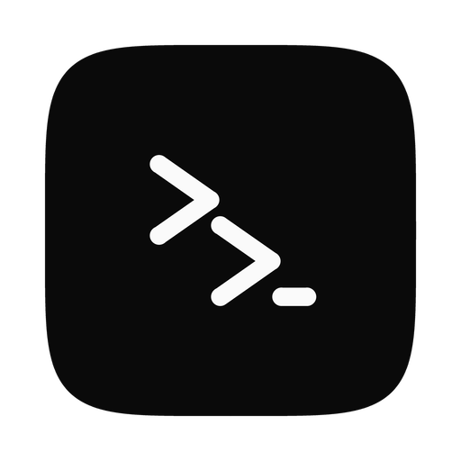

<p align="center">
  
</p>

<h1 align="center">Zorvo</h1>

<p align="center">
  <strong>Every coding agent. One desktop.</strong><br>
  One Mac app for Claude Code, Codex, Qwen Code, Gemini CLI and the other agents in the
  <a href="https://agentclientprotocol.com">ACP registry</a>, each in a real chat.
</p>

<p align="center">
  <a href="https://github.com/zakyirsyaad/zorvo-releases/releases/latest"></a>
  <a href="https://github.com/zakyirsyaad/zorvo-releases/releases"></a>
  
</p>

<p align="center">
  <a href="https://github.com/zakyirsyaad/zorvo-releases/releases/latest/download/Zorvo-mac.dmg"><strong>Download for Mac</strong></a>
  ·
  <a href="https://github.com/zakyirsyaad/zorvo-releases/releases">All releases</a>
  ·
  <a href="CHANGELOG.md">Changelog</a>
  ·
  <a href="https://github.com/zakyirsyaad/zorvo-releases/issues/new/choose">Report a problem</a>
</p>

> [!NOTE]
> Zorvo is not signed by Apple yet, so macOS blocks it the first time you open
> it. [Opening it the first time](#open-zorvo-the-first-time) takes one extra
> step.

## Contents

- [Quick start](#quick-start)
- [What you can do](#what-you-can-do)
- [Supported agents](#supported-agents)
- [Requirements](#requirements)
- [Install](#install)
- [Getting started](#getting-started)
- [Privacy and your data](#privacy-and-your-data)
- [Troubleshooting](#troubleshooting)
- [Questions](#questions)
- [Feedback and security](#feedback-and-security)

## Quick start

1. [Download **Zorvo-mac.dmg**](https://github.com/zakyirsyaad/zorvo-releases/releases/latest/download/Zorvo-mac.dmg),
   open it, and drag Zorvo into **Applications**.
2. Open Zorvo, then allow it once in **System Settings → Privacy & Security →
   Open Anyway** ([details](#open-zorvo-the-first-time)).
3. Follow the onboarding: pick your agents and a project folder. Zorvo installs
   what an agent needs, Node.js included.
4. Click **+ New** and send your first message.

## What you can do

### Work with any agent

- **The agent's own options.** Zorvo talks to every agent over the
  [Agent Client Protocol](https://agentclientprotocol.com), so you get its real
  models, effort levels, modes and slash commands, including the ones your
  skills and plugins add.
- **An agent catalog.** Settings → Agents lists every agent in the ACP
  registry. Add, install, update and remove agents there.
- **Sign in without leaving the app.** An agent's own login runs in a terminal
  inside Zorvo. When an agent needs an answer from you, it can show a form in
  the chat, or send you to a web page.
- **Pick up where you left off.** Continue a session you started in an agent's
  own CLI, and sessions resume after a restart.

### Stay in control

- **Approve what the agent does.** Permission requests appear in the chat with
  the agent's own choices, and every new session starts in the safest mode its
  agent offers.
- **See every change.** Each file the agent changes comes with its diff. The
  Changes panel lets you review them and commit the files you choose.
- **Know when an agent is stuck.** If an agent reports failed requests, or has
  sent nothing for a minute, Zorvo says so under **Working…**, with a Stop
  button.
- **Follow your pull request.** The top bar shows your branch's pull request and
  its checks, read with your own `gh`.

### Keep your work organized

- **Sessions by folder.** Sessions are titled from your first message and saved
  on your Mac. Rename, pin and archive them, or pop one out into its own window.
  An unread mark shows which agent finished while you were away.
- **Fork and rewind.** Fork any reply into a new session, or rewind to before
  one of your messages and send it again, edited.
- **Worktrees.** Run a session in its own git worktree on an `agent/<title>`
  branch, so agents in the same repository never edit the same files.
- **A terminal where the agent works.** The **Terminal** button opens a shell in
  the session's folder, in a drawer under the chat, with tabs per folder.
- **A composer that knows your project.** Mention files with `@`, drop files or
  pictures onto the window, and click the context meter to see the tokens used,
  the tokens left and the cost.

## Supported agents

Zorvo runs every agent in the [ACP registry](https://agentclientprotocol.com).
**Claude Code, Codex and Qwen Code** are on by default, along with any registry
agent already installed on your Mac. Add the others, such as Gemini CLI, from
**Settings → Agents**.

Every agent works the same way in Zorvo: its own models, effort and modes,
approvals in the chat, fork and rewind. A session continues after a restart
when its agent can resume or reload sessions; an agent that cannot says so.

A new version of an agent is offered a week after it was published, never
sooner, and never one the registry has withdrawn.

## Requirements

- **A Mac** with Apple Silicon or Intel.
- **Node.js 22 or newer** for the agents that run with `npx` (Claude Code,
  Codex, Qwen Code and many others). If yours is missing or older, Zorvo
  installs its own when you install such an agent.
- **An account with at least one agent.** Each agent signs in with its own
  tools; Zorvo never asks for your API keys.

  | Agent | Sign in | Optional global install |
  |---|---|---|
  | Claude Code | The sign-in panel in Zorvo, or `claude` then `/login` | `npm i -g @anthropic-ai/claude-code` |
  | Codex | The sign-in panel in Zorvo, or `codex login` | `npm i -g @openai/codex` |
  | Qwen Code | Run `qwen` once in a terminal | `npm i -g @qwen-code/qwen-code` |

  A global install is not needed; it only makes an agent show up as installed
  before you first use it.
- **Optional: the [GitHub CLI](https://cli.github.com)**, signed in with
  `gh auth login`, to see pull requests and their checks.

Zorvo reads your login shell's environment, so it finds whatever your terminal
finds. If you install an agent while Zorvo runs, click **Check again** in
Settings → Agents.

## Install

### Download

Download [**Zorvo-mac.dmg**](https://github.com/zakyirsyaad/zorvo-releases/releases/latest/download/Zorvo-mac.dmg)
from the latest release. One file works on both Apple Silicon and Intel Macs.
Open it and drag **Zorvo** into **Applications**.

### Open Zorvo the first time

Zorvo is not signed by Apple yet, so macOS blocks it the first time:

1. Open Zorvo from Applications. macOS says it cannot be opened; click **Done**.
2. Open **System Settings → Privacy & Security**, scroll down, and click
   **Open Anyway** next to the message about Zorvo.
3. Confirm, and Zorvo opens. From then on it opens normally.

macOS 15 and later no longer offer right-click → Open for this. If you prefer
the terminal, this does the same:

```bash
xattr -dr com.apple.quarantine "/Applications/Zorvo.app"
```

### Check your download

Each release lists the SHA-256 checksum of its files in `SHA256SUMS.txt`.
Download it into the folder with the DMG, then run this in that folder:

```bash
shasum -a 256 -c SHA256SUMS.txt --ignore-missing
```

`Zorvo-mac.dmg: OK` means you have the exact file the release published. Only
download Zorvo from this repository's
[releases](https://github.com/zakyirsyaad/zorvo-releases/releases).

### Update

Zorvo does not update itself yet. To update, download the newest DMG and
replace Zorvo in Applications. Your sessions are kept: they are stored outside
the app.

### Uninstall

Quit Zorvo and move it from Applications to the Trash. To remove your data as
well, delete `~/Library/Application Support/xyz.zorvo.desktop/`. It holds your
sessions, their worktrees and the agents Zorvo installed.

### Coming from Agent Desktop

Zorvo is installed next to the old Agent Desktop app and copies its sessions on
first launch. Then delete Agent Desktop from Applications: both apps share the
old sessions' worktrees, so deleting a session in one would remove its worktree
in the other. macOS asks again for notification and folder permissions.

## Getting started

1. **Onboarding.** The first run checks which agents are installed, lets you
   pick a default, and asks for a project folder.
2. **Start a session.** Click **+ New**, or the **+** next to a folder to choose
   its agent. In the composer, pick the folder, branch, model, effort and
   permission mode, then send your first message. Turn on **Worktree** first to
   give the session its own checkout.
3. **Work with the agent.**
   - Answer its permission requests in the chat.
   - Open **Files** to browse the folder, and **Changes** to review and commit
     what it changed.
   - Open **Terminal** for a shell in the same folder.
4. **Branch off.**
   - **Fork** under any reply starts a new session from there.
   - **↺ Rewind** under one of your messages takes the conversation back to
     before it and puts the message in the composer to edit. Files the agent
     changed stay as they are.

Each session starts in the safest permission mode its agent offers (its
**Default**, **Manual**, **Ask** or **Read-only** mode), so the agent asks
before it edits files or runs commands. Pick another mode in the composer.

## Privacy and your data

- **Your keys stay with the agents.** Zorvo never asks for or stores API keys
  or tokens. Agents sign in with their own tools, and pull request data comes
  from your own `gh` login.
- **No telemetry.** Zorvo sends nothing about you or your work anywhere.
- **Only a few hosts, all named.** Zorvo itself contacts only:
  - the ACP registry (`cdn.agentclientprotocol.com`), to list agents, their
    versions and their logos;
  - an agent's download URLs from the registry, when you install a binary
    agent;
  - `nodejs.org`, when you install an agent that needs Node.js and yours is
    missing or older than 22;
  - `uv`'s releases on GitHub, when you install an agent that runs with `uvx`
    and you have no `uvx`.

  Nothing downloads until you click **Install**, and every download is checked
  against a SHA-256 hash pinned in advance. Your agents, and the `npm`, `npx`
  and `uvx` they run with, make their own requests to their own services.
- **Your data stays on your Mac.** Sessions and transcripts are stored in
  `~/Library/Application Support/xyz.zorvo.desktop/`, and session worktrees in
  `worktrees/` there.
- **Only the folders you open.** Zorvo reads and runs commands only in folders
  you opened in the app.

## Troubleshooting

| Problem | What to try |
|---|---|
| macOS blocks Zorvo on first open | See [Open Zorvo the first time](#open-zorvo-the-first-time). |
| An agent shows as not installed | Click **Install** next to it in Settings → Agents, or pick it in a new session's agent list and click **Install**. Zorvo brings Node.js or `uv` when the agent needs them. Then click **Check again**. |
| "Sign in to *agent*" | Use a sign-in method the panel offers, or sign in once in a terminal (see [Requirements](#requirements)), then send your message again. |
| An agent takes a while to start the first time | Its first start downloads the agent's package. Later starts are quick. |
| The agent stays on **Working…** | If Zorvo shows that the agent's requests failed, the cause is usually the agent's account, such as a used-up quota. Check it in the agent's own CLI, then click **Stop** and send your message again. |
| No pull request status | Install `gh` and run `gh auth login`. A repository without a GitHub remote has none to show. |
| "is not in the last commit, so a worktree would not have it" | A worktree checks out the last commit. Commit the folder first, or start the session without **Worktree**. |

Still stuck? [Open an issue](https://github.com/zakyirsyaad/zorvo-releases/issues/new/choose)
with your Zorvo version, shown at the bottom of the sidebar.

## Questions

**Does Zorvo need my API keys?** No. Each agent signs in with its own tools,
and Zorvo never asks for or stores keys or tokens.

**Does it work on Windows or Linux?** Not yet. Zorvo is a Mac app for now.

**Is the source code available?** No. This repository holds Zorvo's releases
and this guide.

**Which agent should I start with?** The one you already use. Zorvo shows each
agent's own models and modes, so it works the way that agent does, next to the
others.

## Feedback and security

- **Found a problem or have an idea?**
  [Open an issue](https://github.com/zakyirsyaad/zorvo-releases/issues/new/choose).
  Never paste API keys, tokens or other secrets into an issue.
- **Found a security problem?** Report it privately, as described in
  [SECURITY.md](SECURITY.md), not in a public issue.

The files here are published from Zorvo's private source with each release, so
pull requests to this repository cannot be merged.

## License

Zorvo is not open source. All rights are reserved by the author.
